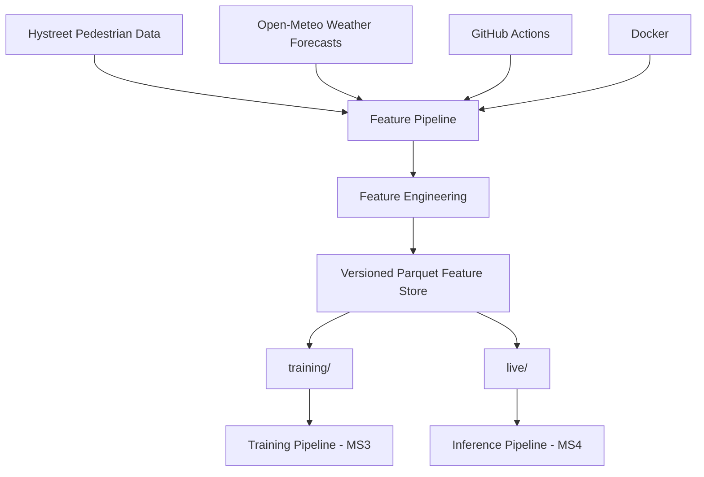

# Zurich Footfall Forecast

An MLOps project for forecasting pedestrian traffic at **Bahnhofstrasse (Mitte), Zurich**.

The system follows a **Feature–Training–Inference (FTI)** architecture.

The current milestone, **MS2**, implements the feature pipeline:

- Live data ingestion
- Historical backfill
- Feature engineering
- Versioned Parquet feature storage
- Automated tests
- Scheduled execution with GitHub Actions
- Docker containerization
- Reproducible dependency management with `uv`

The final system will predict pedestrian traffic **24 hours ahead** and is planned to provide **P10 / P50 / P90 quantile forecasts**.

---

## Project Goal

The goal of this project is to build an automated machine learning system that predicts pedestrian traffic at:

**Bahnhofstrasse (Mitte), Zurich**

with a forecast horizon of:

**24 hours ahead**

The final system follows the FTI architecture:

```text
Feature Pipeline
      |
      v
Feature Store
      |
      v
Training Pipeline
      |
      v
Model Registry
      |
      v
Inference Pipeline
      |
      v
Predictions / UI
```

At the current MS2 milestone, the **Feature Pipeline and versioned feature storage** are implemented.

---

## Architecture



The feature pipeline supports two execution modes:

- **Backfill mode**: builds historical training features.
- **Live mode**: builds the newest available feature row.

---

## Data Sources

### Hystreet / Open Data Zurich

Pedestrian measurements are loaded from the public Hystreet pedestrian frequency dataset published by the City of Zurich.

The pipeline:

1. Downloads the current Hystreet CSV.
2. Filters the dataset to Bahnhofstrasse (Mitte).
3. Converts timestamps to UTC.
4. Sorts observations chronologically.
5. Checks duplicate timestamps.
6. Validates hourly continuity.

Configured location:

```text
Location ID:   329
Location name: Bahnhofstrasse (Mitte)
```

The Hystreet dataset contains historical observations going back to 2021.

The source and location configuration are stored in:

```text
config/settings.yaml
```

### Open-Meteo

Weather forecasts are retrieved from Open-Meteo.

Two different APIs are used.

#### Historical Weather

The backfill pipeline uses the **Open-Meteo Previous Runs API**.

This allows the training dataset to use weather forecasts that would actually have been available at prediction time.

Historical model features therefore use archived **24-hour-ahead forecasts** instead of observed historical weather.

#### Live Weather

The live pipeline uses the current **Open-Meteo Forecast API**.

For a prediction timestamp `t`, the pipeline selects the weather forecast corresponding to:

```text
target_timestamp = t + 24 hours
```

The configured weather model is:

```text
dwd_icon_d2
```

---

## Time Handling

All joins, lags, targets, and weather timestamps are handled internally in:

```text
UTC
```

Calendar features are calculated using:

```text
Europe/Zurich
```

This ensures that local features such as hour, weekday, weekend, holidays, and events remain correct during daylight-saving-time changes.

---

## Feature Engineering

For every prediction timestamp `t`, the pipeline creates:

```text
target_timestamp = t + 24 hours
```

### Pedestrian Lag Features

The following pedestrian lag features are used:

```text
pedestrians_lag_24h
pedestrians_lag_168h
```

Conceptually:

```text
lag_24h(t)  = pedestrians(t - 24h)
lag_168h(t) = pedestrians(t - 168h)
```

The lag features use timestamp-based joins.

### Rolling Features

The following rolling pedestrian means are calculated:

```text
pedestrians_mean_3h_lag24h
pedestrians_mean_6h_lag24h
pedestrians_mean_24h_lag24h
```

All rolling windows end at:

```text
t - 24 hours
```

This prevents recent potentially unverified Hystreet observations from entering the rolling features.

Unverified observations are excluded from rolling calculations.

### Weather Features

The weather features are:

```text
forecast_temperature
forecast_precipitation
forecast_weather_code
```

These represent the weather forecast for the future target timestamp.

For example:

```text
Prediction timestamp: 2026-10-31 18:00 UTC
Target timestamp:     2026-11-01 18:00 UTC
```

The weather features correspond to the forecast for:

```text
2026-11-01 18:00 UTC
```

### Calendar Features

The following calendar features are calculated for the target timestamp:

```text
target_hour
target_day_of_week
target_is_weekend
target_month
```

Calendar features use local Zurich time.

### Holiday Feature

Swiss public holidays for the canton of Zurich are represented by:

```text
target_is_holiday
```

The project uses the Python `holidays` package with:

```text
Country: CH
Subdivision: ZH
```

### Event Features

Currently configured event features include:

```text
target_is_street_parade_impact
target_is_sechselaeuten
```

The corresponding dates are configured in:

```text
config/settings.yaml
```

---

## Training Targets

Historical training features additionally contain:

```text
target_pedestrians
target_unverified
```

`target_pedestrians` is the actual pedestrian count observed at:

```text
t + 24 hours
```

`target_unverified` indicates whether Hystreet has already verified the corresponding observation.

These columns are only present in historical training features.

They are intentionally not present in live feature snapshots because the future target is not yet known.

---

## Feature Storage

For MS2, the project uses **versioned Parquet files** as a lightweight feature store.

The structure is:

```text
data/
└── features/
    ├── training/
    │   └── footfall_features_<timestamp>.parquet
    │
    └── live/
        └── footfall_features_<timestamp>.parquet
```

Example:

```text
footfall_features_20261101T115007Z.parquet
```

The timestamp in the filename prevents normal pipeline runs from overwriting previous snapshots.

The complete `data/` directory is excluded from Git.

### Training Features

Files under:

```text
data/features/training/
```

contain historical feature rows and training targets.

The current full MS2 backfill contains:

```text
24,384 hourly rows
```

with target timestamps from:

```text
2024-01-20 00:00 UTC
to
2026-10-31 23:00 UTC
```

### Live Features

Files under:

```text
data/features/live/
```

contain the newest available feature row.

One live row represents:

```text
one prediction timestamp
+
all currently available model features
```

The live pipeline currently creates one new snapshot per execution.

---

## Data Quality

The ingestion and feature pipeline performs validation checks for:

- Required columns
- Duplicate timestamps
- Hourly continuity
- Prediction horizon
- Expected feature schema

The full historical backfill contains:

```text
24,384 rows
```

The following data-quality cases were identified:

```text
52 rows with missing forecast_temperature
1 row with target_unverified = True
```

The 52 missing temperature values occur during a short period in April 2026.

The feature store intentionally preserves these rows.

The future MS3 training pipeline will exclude rows that are not suitable for model training.

After excluding these observations, the currently usable dataset contains:

```text
24,331 rows
```

---

## Running the Feature Pipeline

The feature pipeline supports two modes.

### Live Pipeline

The live pipeline:

1. Downloads the latest Hystreet dataset.
2. Filters Bahnhofstrasse (Mitte).
3. Finds the newest available Hystreet timestamp.
4. Downloads the current Open-Meteo forecast.
5. Selects the weather forecast for `t + 24h`.
6. Builds all live features.
7. Stores the newest feature row.

Run:

```bash
PYTHONPATH=src uv run python -m footfall.features.pipeline live
```

The output is stored in:

```text
data/features/live/
```

### Historical Backfill

The backfill pipeline builds historical training features for a selected period.

Example:

```bash
PYTHONPATH=src uv run python -m footfall.features.pipeline backfill \
  --start-date 2024-01-20 \
  --end-date 2026-10-31
```

The output is stored in:

```text
data/features/training/
```

---

## Automated Execution with GitHub Actions

The live feature pipeline is scheduled using GitHub Actions.

The workflow is defined in:

```text
.github/workflows/feature_pipeline.yml
```

The workflow is configured to run approximately every three hours.

The workflow performs the following steps:

```text
GitHub Actions scheduler
        |
        v
Checkout repository
        |
        v
Set up Python
        |
        v
Install uv
        |
        v
Install locked dependencies
        |
        v
Run tests
        |
        v
Run live feature pipeline
        |
        v
Upload generated Parquet file
```

The workflow can also be started manually:

```text
GitHub
-> Actions
-> Feature Pipeline
-> Run workflow
```

### GitHub Actions Artifacts

GitHub-hosted runners are temporary.

Therefore, generated Parquet files are uploaded as GitHub Actions artifacts after each scheduled run.

Artifact name:

```text
live-feature-snapshot
```

Artifacts are currently retained for:

```text
30 days
```

GitHub Actions artifacts are used as temporary storage for the MS2 implementation.

A persistent cloud-backed feature store such as Google Cloud Storage is planned for later milestones.

---

## Testing

The project contains unit tests for the most important feature and storage logic.

Tests currently cover:

- `t + 24h` target generation
- 24-hour lag
- 168-hour lag
- Rolling features
- Exclusion of unverified observations from rolling features
- Zurich holiday features
- Zurich event features
- Timezone handling
- Target calendar features
- Training feature storage
- Live feature storage
- Invalid feature-store types

Run all tests with:

```bash
PYTHONPATH=src uv run python -m pytest -v
```

---

## Docker

The feature pipeline is containerized with Docker.

The Docker image contains:

- Python 3.10
- `uv`
- Locked project dependencies
- Project source code
- Project configuration

The default container command runs the live feature pipeline.

### Build the Docker Image

From the repository root:

```bash
docker build -t zurich-footfall .
```

### Run the Live Pipeline with Docker

```bash
docker run --rm \
  -v "$(pwd)/data:/app/data" \
  zurich-footfall
```

The volume:

```text
$(pwd)/data:/app/data
```

connects the local `data/` directory with `/app/data` inside the container.

This ensures that generated Parquet files remain available after the temporary container stops.

### Run a Backfill with Docker

```bash
docker run --rm \
  -v "$(pwd)/data:/app/data" \
  zurich-footfall \
  uv run --no-sync python -m footfall.features.pipeline backfill \
  --start-date 2024-01-20 \
  --end-date 2026-10-31
```

Note: Change the end-date to the desired day.

---

# Local Setup

The following instructions explain how to install and run the project on a new machine.

## Requirements

Install the following tools:

- Git
- Python 3.10
- `uv`

Docker is optional for normal local execution but required for running the containerized version.

The project currently requires:

```text
Python >=3.10,<3.11
```

---

## 1. Clone the Repository

```bash
git clone https://github.com/Deeliodas/MLOPS
```

Enter the project directory:

```bash
cd MLOPS
```


---

## 2. Check Python

```bash
python --version
```

Expected:

```text
Python 3.10.x
```

---

## 3. Install uv

If `uv` is not installed:

```bash
python -m pip install uv
```

Check the installation:

```bash
uv --version
```

---

## 4. Install Dependencies

From the repository root:

```bash
uv sync --locked
```

This creates the project environment and installs the dependency versions defined in:

```text
uv.lock
```

---

## 5. Run the Tests

```bash
PYTHONPATH=src uv run python -m pytest -v
```

All tests should pass before running the pipeline.

---

## 6. Run the Live Pipeline

```bash
PYTHONPATH=src uv run python -m footfall.features.pipeline live
```

A versioned Parquet file should be created under:

```text
data/features/live/
```

---

## 7. Run a Historical Backfill

Example:

```bash
PYTHONPATH=src uv run python -m footfall.features.pipeline backfill \
  --start-date 2024-01-20 \
  --end-date 2024-01-31
```

Note: Change the end-date to the desired day.

The generated feature file will appear under:

```text
data/features/training/
```

---

## 8. Optional: Run with Docker

Build:

```bash
docker build -t zurich-footfall .
```

Run:

```bash
docker run --rm \
  -v "$(pwd)/data:/app/data" \
  zurich-footfall
```

---

## Configuration

Project configuration is stored in:

```text
config/settings.yaml
```

The configuration includes:

- Hystreet source
- Location ID
- Polling interval
- Forecast horizon
- Pedestrian lags
- Rolling windows
- Local timezone
- Weather provider
- Weather model
- Open-Meteo endpoints
- Event dates
- Feature-store paths

The configuration is loaded by:

```text
src/footfall/common/config.py
```

---

## Environment Variables and Secrets

Local environment variables can be stored in:

```text
.env
```

The real `.env` file must never be committed.

The repository contains:

```text
.env.example
```

as a template.

The following are excluded through `.gitignore`:

```text
.env
data/
.venv/
__pycache__/
.pytest_cache/
```

The current public Hystreet and Open-Meteo APIs do not require project API keys.

Future cloud credentials must be managed using GitHub Secrets or a cloud secret-management service.

---

## Repository Structure

```text
MLOPS/
├── .github/
│   └── workflows/
│       └── feature_pipeline.yml
│
├── config/
│   └── settings.yaml
│
├── docs/
│   └── proposal.pdf
│
├── scripts/
│
├── src/
│   └── footfall/
│       ├── common/
│       │   ├── __init__.py
│       │   └── config.py
│       │
│       ├── features/
│       │   ├── __init__.py
│       │   ├── build_features.py
│       │   ├── ingest.py
│       │   ├── ingest_weather.py
│       │   ├── pipeline.py
│       │   └── store.py
│       │
│       ├── inference/
│       ├── training/
│       └── __init__.py
│
├── tests/
│   ├── test_build_features.py
│   └── test_store.py
│
├── ui/
│
├── .dockerignore
├── .env.example
├── .gitignore
├── docker-compose.yaml
├── Dockerfile
├── pyproject.toml
├── README.md
└── uv.lock
```

Generated feature data is stored locally under:

```text
data/
└── features/
    ├── training/
    └── live/
```

The `data/` directory is excluded from Git because it contains generated feature snapshots.

Local notebooks used for development and data inspection are also excluded from the repository when they are not required to reproduce the pipeline.

### Main Components

- `config/settings.yaml` – central project and feature configuration.
- `src/footfall/common/` – shared configuration utilities.
- `src/footfall/features/` – data ingestion, feature engineering, feature storage, backfill, and live pipeline logic.
- `src/footfall/training/` – reserved for the MS3 training pipeline.
- `src/footfall/inference/` – reserved for the later inference pipeline.
- `tests/` – unit tests for feature engineering and feature storage.
- `.github/workflows/feature_pipeline.yml` – scheduled GitHub Actions feature pipeline.
- `Dockerfile` – container definition for running the feature pipeline.
- `docker-compose.yaml` – Docker Compose configuration.
- `pyproject.toml` and `uv.lock` – project dependencies and reproducible dependency versions..

---

## MS2 Implementation Status

Implemented for MS2:

- Automated Hystreet data ingestion
- Open-Meteo weather ingestion
- Historical backfill
- Feature engineering
- Versioned Parquet feature storage
- Separate training and live feature snapshots
- Unit tests
- Scheduled GitHub Actions workflow
- GitHub Actions artifact storage
- Docker image
- Locked dependencies with `uv.lock`

---

## Current Limitations

### Local Feature Store

The current feature store uses local versioned Parquet files.

A persistent cloud-backed feature store such as **Google Cloud Storage** is planned for later milestones.

### Independent Live Snapshots

Each live pipeline run currently creates a new snapshot containing the newest available feature row.

The snapshots are not yet consolidated into a continuously growing cloud dataset.

### GitHub Actions Scheduling

GitHub Actions is configured to run approximately every three hours.

GitHub Actions scheduling is best-effort, so individual runs may start later than the configured cron time.

A cloud-native scheduler may replace GitHub Actions for the final production system.

### Historical Weather Gap

The historical weather dataset contains 52 rows with missing:

```text
forecast_temperature
```

during a short period in April 2026.

These observations will be excluded during model training.

### No Trained Model Yet

MS2 implements the Feature Pipeline only.

The following components are planned for future milestones:

- Training Pipeline
- MLflow experiment tracking
- Model Registry
- P10 / P50 / P90 quantile models
- Inference Pipeline
- Prediction UI
- Cloud deployment
- Monitoring and drift detection

---

## Planned MS3 Architecture

The next milestone introduces the Training Pipeline.

```text
Versioned Training Features
        |
        v
Training Pipeline
        |
        v
Data Quality Filtering
        |
        v
Train and Evaluate Model
        |
        v
MLflow Experiment Tracking
        |
        v
Model Registry
```

The Training Pipeline will read the features produced by the MS2 Feature Pipeline.

It will not recompute the feature engineering logic.

---

## Planned Cloud Architecture

The current versioned Parquet structure can later be moved to cloud storage.

A possible structure is:

```text
Google Cloud Storage
├── features/
│   ├── training/
│   └── live/
│
├── predictions/
└── models/
```

This allows the same containerized pipeline code to run without depending on a local machine.

---

## Reproducibility

The project uses:

- `pyproject.toml`
- `uv.lock`
- Docker
- Automated tests
- Versioned feature snapshots
- Central project configuration

to make pipeline execution reproducible.

---


## Milestone Roadmap

### MS1 – Project Proposal

Completed.

### MS2 – Feature Pipeline

Current milestone.

Implemented:

- Data ingestion
- Backfill
- Feature engineering
- Feature storage
- Scheduling
- Testing
- Docker
- Reproducible dependencies

### MS3 – Training Pipeline

Planned.

### MS4 – Live System

Planned.

The final system will combine all three FTI pipelines into an automated cloud-deployed machine learning application.